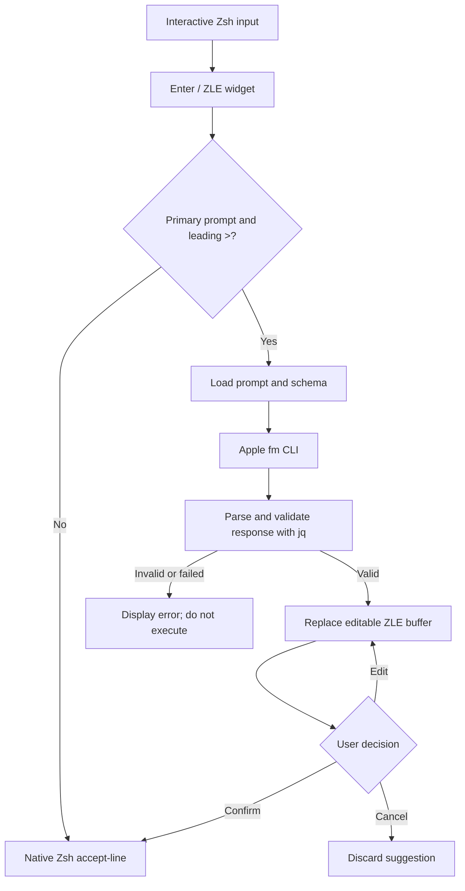

# zphrase

**Type naturally. Execute natively.**

zphrase is a lightweight, local-first natural language extension for Zsh, powered by Apple's Foundation Models CLI (`fm`). It brings AI-assisted command generation to your existing terminal without replacing your shell, installing a terminal emulator, or introducing a Python or Swift application runtime.

Type a request beginning with `>`, press Enter, review the generated shell command, and press Enter again to execute it.

```text
% > find all Python files

% find . -type f -name '*.py'
Recursively find Python files. | Enter: Execute | Ctrl+C: Cancel
```

> [!NOTE]
> zphrase is an early prototype. Command translation is the current feature; command explanation and error repair prompts are included as foundations for future functionality.

## Features

- **Natural language commands:** use `>` to explicitly request AI assistance.
- **Local-first inference:** use Apple's on-device system model by default, without a third-party API key or subscription.
- **Human-controlled execution:** generated commands are placed in the editable Zsh command buffer, not executed automatically.
- **Native shell behaviour:** ordinary commands bypass AI inference and run in your existing Zsh session.
- **Structured responses:** command suggestions and explanations are returned using an Apple `fm` generation schema and parsed with `jq`.
- **Customisable prompts:** edit plain-text prompt files without changing the shell integration logic.
- **Terminal-independent:** works with interactive Zsh sessions in Terminal.app, Ghostty, iTerm2, and other compatible terminal emulators.
- **Minimal architecture:** no custom terminal emulator, agent framework, background daemon, or database required.

## Requirements

| Requirement | Purpose |
| --- | --- |
| macOS 27 or later | Includes Apple's `fm` CLI |
| Apple Intelligence-compatible Mac with the on-device model available | Local inference |
| Zsh | Interactive shell and Zsh Line Editor (ZLE) |
| `jq` | Parse and validate structured model responses |
| Git (optional) | Clone and update the repository |

Homebrew is optional; it is one way to install `jq`.

Check the required tools and initialise `fm` if necessary:

```sh
command -v zsh
command -v fm
command -v jq
fm respond --help
fm respond "Reply with OK."
```

If prompted, review and accept Apple's Foundation Models CLI terms. Ensure Apple Intelligence is enabled and its model is available before continuing.

If `jq` is missing and you use Homebrew:

```sh
brew install jq
```

## Installation

### 1. Install the repository

Place a copy of this repository at `~/.zsh/plugins/zphrase`. From the root of an existing local checkout:

```sh
mkdir -p "$HOME/.zsh/plugins/zphrase"
cp plugin.zsh "$HOME/.zsh/plugins/zphrase/"
cp -R prompts schemas "$HOME/.zsh/plugins/zphrase/"
```

Alternatively, clone your repository directly to that location, or source `plugin.zsh` from any existing checkout. Keep the `prompts/` and `schemas/` directories alongside `plugin.zsh`.

### 2. Enable the plugin

Add this line near the end of `~/.zshrc`, after any shell framework and keybinding configuration:

```zsh
source "$HOME/.zsh/plugins/zphrase/plugin.zsh"
```

Or append it from your terminal, including a leading newline to avoid joining the previous line:

```sh
printf '\n%s\n' 'source "$HOME/.zsh/plugins/zphrase/plugin.zsh"' >> "$HOME/.zshrc"
```

Only add the source line once. If you installed the repository elsewhere, adjust the path accordingly.

### 3. Reload Zsh

```sh
zsh -n "$HOME/.zsh/plugins/zphrase/plugin.zsh" && source "$HOME/.zshrc"
```

Open a new terminal tab if you are replacing an older version of the plugin or if an existing keybinding remains active.

## Usage

At an ordinary interactive Zsh prompt, type a natural language request prefixed with `>` and press Enter.

```text
> find all Python files
```

zphrase calls the model, validates the response, and replaces the input with a suggested command. Review or edit it before pressing Enter again. Press `Ctrl+C` to discard the suggestion in a standard Zsh configuration.

Both `>request` and `> request` are supported.

### Examples

These are illustrative suggestions; actual output depends on the model and the request.

| Natural language input | Possible command |
| --- | --- |
| `> list hidden files` | `ls -a` |
| `> find all Python files` | `find . -type f -name '*.py'` |
| `> show available disk space` | `df -h` |
| `> show my current Git branch` | `git branch --show-current` |
| `> list files sorted by size` | `ls -lSh` |
| `> find files modified in the last seven days` | `find . -type f -mtime -7` |

Ordinary commands work as usual:

```sh
ls -la
git status
cd ~/Documents
```

### Reserved prefix

zphrase deliberately reserves leading `>` at the primary interactive prompt for natural language input. This includes standalone redirections such as `> file.txt` and `>> file.txt`. Redirections elsewhere in a normal command are unaffected.

Use explicit native commands instead:

```sh
touch file.txt           # Create a file if it does not exist
: > file.txt             # Create or truncate a file
: >> file.txt            # Create a file or leave its contents intact
echo hello > file.txt    # Redirect command output normally
```

## Architecture

zphrase treats the LLM as a composable Unix utility, not an autonomous agent.



The plugin registers a custom ZLE widget and binds Enter (`^M` and `^J`) to it. For ordinary commands, the widget delegates to Zsh's `accept-line`. For AI requests, it loads the translation prompt and schema, calls `fm`, extracts the command and explanation, and updates `BUFFER` and `CURSOR`. Execution remains the responsibility of the user's shell.

Because zphrase operates within the existing Zsh session, confirmed commands can use the current working directory, aliases, functions, and shell environment. However, the model does not automatically receive all of that state; the current request includes only the OS, shell, working directory and user input.

## Repository structure

```text
zphrase/
├── plugin.zsh
├── prompts/
│   ├── translate.txt
│   ├── explain.txt
│   └── repair.txt
├── schemas/
│   └── suggestion.json
├── README.md
└── LICENSE
```

| File | Responsibility |
| --- | --- |
| `plugin.zsh` | ZLE integration, deterministic routing, model invocation, response validation and preview |
| `prompts/translate.txt` | Instructions for converting natural language to macOS-compatible Zsh commands |
| `prompts/explain.txt` | Instructions for explaining commands, reserved for a future interactive mode |
| `prompts/repair.txt` | Instructions for diagnosing command errors, reserved for a future interactive mode |
| `schemas/suggestion.json` | Structured generation contract for command suggestions |
| `README.md` | Project documentation |
| `LICENSE` | Repository licence, when supplied |

## Configuration and customisation

### Model selection

The plugin uses the Apple system model by default. The model name can be configured before sourcing the plugin in `.zshrc`:

```zsh
export zphrase_MODEL=system
source "$HOME/.zsh/plugins/zphrase/plugin.zsh"
```

Check `fm respond --help` for supported model identifiers on your installed version. Alternative providers are not currently implemented.

### Prompt templates

Edit `prompts/translate.txt` to customise command generation. For example:

```text
You are a macOS Zsh command translator.

Translate the user's natural language request into a valid shell command.
Use macOS-compatible commands and flags.
Prefer native Unix utilities and do not assume GNU tools are installed.
Quote file paths correctly.
Never execute commands.
Explain briefly what the command does.
Return an empty command if the request is ambiguous.
```

The plugin resolves resource paths relative to its own location (`zphrase_ROOT`), so prompts work regardless of the current working directory. Prompt files are read for each request; editing them does not require reloading `.zshrc`.

### Structured generation schema

`schemas/suggestion.json` defines the response contract used by `fm`. Generate it using Apple's schema command if you need to recreate it:

```sh
fm schema object \
  --name CommandSuggestion \
  --string command \
  --string explanation \
  > schemas/suggestion.json
```

Run this command from the repository root. Check `fm schema object --help` if your installed version differs. Use the schema format emitted by `fm` rather than assuming an arbitrary JSON Schema document will be accepted.

Example response (not the schema itself):

```json
{
  "command": "find . -type f -name '*.py'",
  "explanation": "Recursively find Python files."
}
```

The plugin passes the prompt as model instructions and the schema via `--schema`, then uses `jq` to extract and validate the response. If changing the schema fields, update the parser in `plugin.zsh` accordingly.

## Safety and privacy

zphrase is an assistance layer, not a sandbox or a security boundary.

- AI-generated commands require user review and a separate confirmation before execution.
- The current validation rejects empty commands, control characters, code fences and suggestions starting with the reserved prefix. It does not guarantee command correctness or safety.
- Generated commands run with the permissions of your existing shell, just like commands you type yourself. Always review destructive commands, privilege escalation, network requests and shell pipelines before executing them.
- With the default on-device system model, inference is local. The prompt contains the current working directory and user request; avoid entering secrets or sensitive information.
- The current plugin does not deliberately transmit shell history, environment variables or command output to a remote service, and does not maintain its own inference history. Normal shell history settings may still record confirmed commands.

## Troubleshooting

| Issue | What to check |
| --- | --- |
| `fm: command not found` | Check the macOS version and `command -v fm`. |
| Model unavailable or inference failed | Enable Apple Intelligence, run `fm respond "Reply with OK."` directly, and inspect `fm respond --help`. |
| `jq is required` | Install `jq` and ensure it is on `PATH`. |
| Invalid structured response | Check `schemas/suggestion.json`, the translation prompt and the installed `fm` CLI options. |
| `>` does not trigger AI | Ensure the plugin is sourced, check the ZLE binding and use the primary interactive prompt. |
| Enter behaves unexpectedly | Check whether another plugin overrides the Enter binding; source zphrase after keybinding setup. |
| `.zshrc` parse error | Verify that the `source` statement is on its own line and check the file syntax. |

Useful diagnostics:

```sh
zsh -n ~/.zshrc
zsh -n ~/.zsh/plugins/zphrase/plugin.zsh
type _zphrase_accept_line
bindkey '^M'
bindkey '^J'
fm respond --help
fm schema object --help
```

The expected Enter binding is `_zphrase_accept_line`. Syntax checks do not validate model availability or dynamically evaluated startup scripts.

## Uninstallation

Remove or comment out the zphrase `source` line in `~/.zshrc`, then open a new terminal session to restore the normal Enter binding. You can optionally delete the local plugin directory after preserving any custom prompts you want to keep.

## Roadmap

- [x] Explicit `>` natural language routing
- [x] Apple `fm` integration
- [x] External prompt templates and structured command suggestions
- [x] Editable preview and explicit execution confirmation
- [ ] Command explanation mode (e.g. `>? chmod 755`)
- [ ] Error repair mode with explicitly supplied error context (e.g. `>!`)
- [ ] Documentation grounding using local man pages and trusted CLI help
- [ ] Optional Context7 documentation retrieval
- [ ] Optional alternative LLM providers
- [ ] Asynchronous inference and cancellation
- [ ] Automated tests and command translation evaluations

The current implementation is synchronous: the interactive prompt waits for the model to return. The explanation and repair templates do not, by themselves, enable their corresponding modes. These are proposed enhancements, not existing capabilities.

## Design principles

**Deterministic routing. Probabilistic generation. Human-controlled execution.**

zphrase builds on existing Unix primitives. Keep the shell in control of execution, keep AI optional, and avoid introducing a new runtime or terminal emulator unless a concrete requirement justifies it.

## References

- [Apple: Build AI-powered scripts with the fm CLI and Python SDK (WWDC26)](https://developer.apple.com/videos/play/wwdc2026/334/)
- [Zsh Line Editor documentation](https://zsh.sourceforge.io/Doc/Release/Zsh-Line-Editor.html)
- [jq documentation](https://jqlang.org/manual/)

## Licence

See the [LICENSE](LICENSE) file for the applicable terms.
